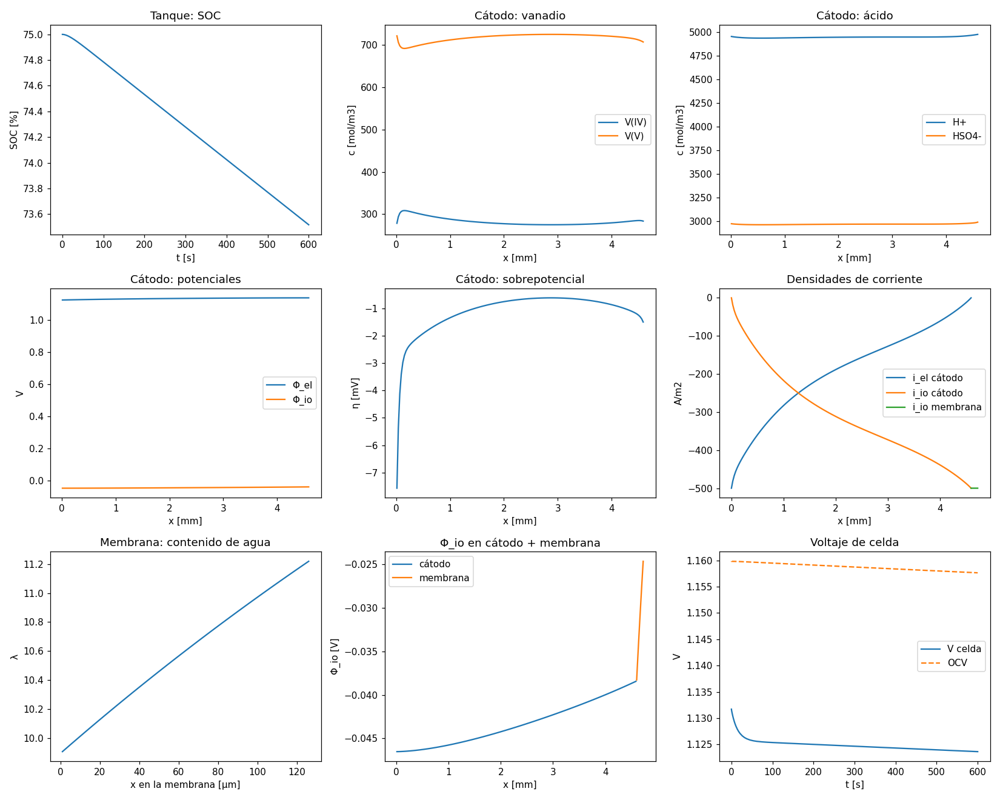

# rfb-model-1D-IIQ3843

Copia docente de **rfbmodel-1D**, el modelo 1-D transitorio de una celda híbrida
hidrógeno–vanadio (HVRFB), preparada para el curso **IIQ3843 Procesamiento de Hidrógeno para
Energías Sostenibles** (Pontificia Universidad Católica de Chile, 2026).

El código original es de J. Barros, F. Huerta y C. A. Pino-Muñoz y está publicado en Zenodo:
[10.5281/zenodo.22274872](https://doi.org/10.5281/zenodo.22274872) (v1, 3 de septiembre de 2026).
Esta copia agrega documentación en español, tutoriales ejecutables y una guía paso a paso para
cada proyecto individual que usa el modelo.



*Salida del [Tutorial 1](docs/02_corrida_base.md): descarga a −500 A/m² desde SOC 0,75, 10 min.*

## Empiece aquí

| Paso | Documento | Tiempo |
| --- | --- | --- |
| 1 | [Instalación](docs/01_instalacion.md) | 15 min |
| 2 | [Corrida base y perfiles en todos los subdominios](docs/02_corrida_base.md) | 30 min |
| 3 | [Arquitectura del código (diagramas UML)](docs/03_arquitectura.md) | 30 min |
| 4 | [Ecuaciones, discretización e implementación](docs/04_ecuaciones.md) | 1 h |
| 5 | [Cómo modificar el modelo](docs/05_modificar_el_modelo.md) | 1 h |
| 6 | La guía de su proyecto en [docs/proyectos/](docs/proyectos/README.md) | — |
| — | [Problemas conocidos y correcciones](docs/06_problemas_conocidos.md) | consulta |

Instalación y primera corrida en tres líneas, desde la raíz del repositorio:

```bash
pip install -e .
pip install -r requirements.txt
python tutoriales/01_corrida_base_perfiles.py
```

## Proyectos individuales que usan este modelo

| Proyecto | Estudiante | Guía | Script de inicio |
| --- | --- | --- | --- |
| P01 Uptake de vanadio y conductividad de la membrana | F. De Col | [P01](docs/proyectos/P01_uptake_vanadio.md) | `tutoriales/P01_inicio.py` |
| P02 Pseudo-2D a lo largo del canal | G. Rifo | [P02](docs/proyectos/P02_pseudo2D.md) | `tutoriales/P02_inicio.py` |
| P03 Resistencias de transporte en ACL y AGDL | M. Rebolledo | [P03](docs/proyectos/P03_anodo.md) | `tutoriales/P03_inicio.py` |
| P28 Transporte de agua y desbalance hídrico | J. Carcelén | [P28](docs/proyectos/P28_agua.md) | `tutoriales/P28_inicio.py` |
| P29 Balance térmico y precipitación de V₂O₅ | F. Navarro | [P29](docs/proyectos/P29_termico.md) | `tutoriales/P29_inicio.py` |
| P31 Distribución de corriente terciaria | S. Mariné | [P31](docs/proyectos/P31_corriente_terciaria.md) | `tutoriales/P31_inicio.py` |

Cada script de inicio corre sin cambios y deja marcado con `TODO` lo que le toca programar.

## Estructura del repositorio

```
rfbmodel1D/          Paquete del modelo (igual a Zenodo salvo una corrección, ver docs/06)
tutoriales/          Scripts del curso: utilidades, tutoriales 1–2 y puntos de partida P01–P31
docs/                Documentación en español (este curso)
scripts/             Scripts originales: validación, ajuste, utilidades
notebooks/           Notebooks originales que generan las figuras del artículo
data/experimental/   Datos experimentales con sus fuentes
results/             Parámetros ajustados del artículo
tests/               Pruebas unitarias
README_rfbmodel1D_original.md   README original del paquete (inglés)
```

## Diferencias con la versión de Zenodo

1. Corrección de conservación de carga en el potencial electrónico del cátodo
   (`rfbmodel1D/meshes/grid_creation/submesh.py`). Con la versión v1, la corriente en la membrana
   excedía la aplicada en 1,5 % a 500 A/m²; ahora cierra con error menor a 10⁻⁵. El voltaje cambia
   0,5 mV. Detalle en [docs/06_problemas_conocidos.md](docs/06_problemas_conocidos.md).
2. Tolerancia de la incógnita de acoplamiento agregada en `scripts/Validation/run_simulation.py`.
3. Carpetas nuevas `docs/` y `tutoriales/`; archivos `requirements.txt` y `CITATION.cff`.

El historial de git conserva la copia exacta de Zenodo en el primer commit.

## Cómo citar

Si usa el código, cite el registro de Zenodo y el artículo asociado
(Barros, Huerta & Pino-Muñoz, `refs/electrochem/HVRFB_paper.pdf` en los materiales del curso).
Ver [`CITATION.cff`](CITATION.cff).

## Licencia

El código se distribuye bajo licencia MIT ([`LICENSE`](LICENSE)); el registro de Zenodo está
bajo CC BY 4.0. La documentación del curso en `docs/` y `tutoriales/` se entrega bajo la misma
licencia MIT.

## Contacto

Profesor: Felipe Huerta. Supervisor de los proyectos HVRFB: Cristóbal Castillo.
Autor del código original: Joaquín Barros.
