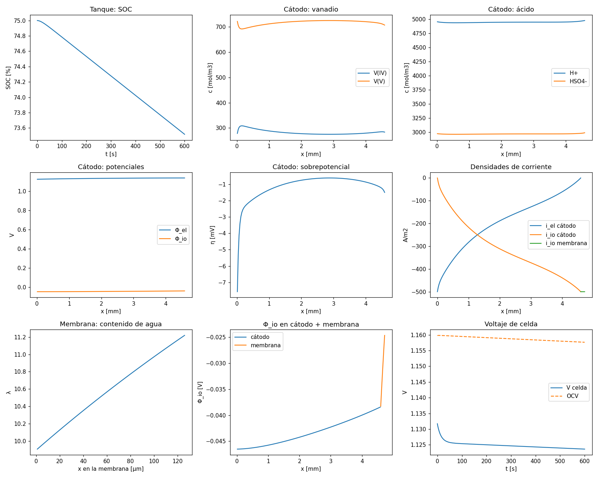

# 2. Corrida base y perfiles en todos los subdominios

Al terminar esta guía usted habrá corrido el modelo completo y sabrá extraer cualquier perfil
(concentraciones, potenciales, sobrepotencial, corrientes, contenido de agua) de cualquier
subdominio. Base: `tutoriales/01_corrida_base_perfiles.py`, unos 10 s de cómputo.

## 2.1 Ejecutar

Desde la raíz del repositorio:

```bash
python tutoriales/01_corrida_base_perfiles.py
```

Salida esperada (el tiempo varía según el computador):

```text
incógnitas: 733
éxito=True  pasos=38  tiempo=6.2 s
V final = 1.1236 V   OCV = 1.1577 V
i_io membrana = -500.00 A/m2   ∫ j dx en el cátodo = -500.00 A/m2
λ membrana: 9.91 – 11.22
ánodo: η_act = 0.521 mV, η_protón = 2.095 mV, s_ACL = 0.1195, c_H2 = 41.98 mol/m3
área = 25 cm2;  figura en resultados\tutorial1_perfiles.png
```

y la figura de nueve paneles:



## 2.2 Qué hace cada bloque del script

El script usa las funciones de `tutoriales/iiq3843_utils.py`, que esconden la indexación del
vector de estado. Abra ambos archivos lado a lado.

1. **Parámetros: `configurar(T_C, Q_ml_min, NC, NM)`.** Los parámetros de
   `rfbmodel1D/parameters/params.py` son atributos de clase de `SimulationParams`; un cambio
   vale para toda la sesión de Python. Deben fijarse **antes** de construir la celda, porque
   `Cell.__init__` calcula una sola vez las difusividades efectivas, las movilidades, la
   viscosidad y la velocidad en el plano del fieltro.
2. **Celda y estado inicial: `construir_celda(soc, modo, valor)`.**
   - `modo="galvanostatico"`: `valor` es la densidad de corriente en el colector catódico
     [A/m²], negativa en descarga.
   - `modo="potenciostatico"`: `valor` es el potencial del colector catódico [V] respecto del
     ánodo, es decir, el voltaje de celda.
   - Internamente llama a `Cell.initialize_dae_state`, que llena todos los nodos con la composición
     del tanque y resuelve dos sistemas con `fsolve`: primero las incógnitas algebraicas (potenciales, η del ánodo,
     c_H de interfaz) y luego las derivadas y′ de las diferenciales. Un integrador DAE necesita
     que F(0, y₀, y′₀) = 0.
3. **Integración: `integrar(cell, y0, yp0, t_final)`.** Llama a
   `solve_dae(cell.dae_residual_full_cell, ...)` con BDF y una tolerancia absoluta por incógnita.
   `sol.t` tiene forma (n_t,) y `sol.y` forma (n_incógnitas, n_t).
4. **Perfiles: `perfiles(cell, y)`.** Evalúa el residuo una vez en `y` (para actualizar η, κ,
   i_io y las condiciones de interfaz, que el modelo guarda como atributos) y devuelve un
   diccionario con todo.

## 2.3 Qué hay en `perfiles(cell, y)`

| Clave | Contenido | Unidades |
| --- | --- | --- |
| `x_ca`, `dx_ca` | centros y anchos de los volúmenes del cátodo, desde el colector (0) a la membrana | m |
| `c_V4`, `c_V5`, `c_H`, `c_HSO4` | concentraciones en el fieltro | mol/m³ |
| `phi_el_ca`, `phi_io_ca` | potencial electrónico e iónico en el cátodo | V |
| `eta_ca` | sobrepotencial η = Φ_el − Φ_io − E_ca | V |
| `j_ca` | corriente de transferencia volumétrica (> 0 oxidación) | A/m³ |
| `kappa_ca` | conductividad iónica local del catolito | S/m |
| `x_m`, `dx_m` | centros y anchos en la membrana, desde la cara del cátodo | m |
| `lam`, `phi_io_m`, `kappa_m` | contenido de agua λ, potencial iónico y κ(λ) en la membrana | –, V, S/m |
| `tanque` | `c_V4`, `c_V5`, `c_H`, `c_HSO4`, `V`, `soc` | mol/m³, m³, – |
| `anodo` | `c_vw_acl`, `c_H2_acl`, `s_acl`, `eta_acl`, `c_vw_agdl`, `c_H2_agdl`, `s_agdl`, `eta_proton` | mol/m³, –, V |
| `i_io` | corriente iónica en la membrana (< 0 descarga) | A/m² |

Otras funciones útiles de `iiq3843_utils.py`:

| Función | Devuelve |
| --- | --- |
| `series_temporales(cell, sol)` | V, OCV, i_io y SOC en cada instante de `sol.t` |
| `voltaje(cell, y)`, `ocv(cell, y)` | voltaje de celda y potencial de circuito abierto [V] |
| `flujos_agua_membrana(cell, y)` | flujos de agua por difusión y arrastre en cada cara de la membrana |
| `cambiar_operacion(cell, y, modo, valor)` | estado consistente tras cambiar corriente o voltaje (ciclos) |
| `rfbmodel1D.post_processing.calculate_current_density(cell, y)` | i_el e i_io en todas las caras |

## 2.4 Lo que debe ver

| Panel | Comportamiento esperado | Qué indica |
| --- | --- | --- |
| Tanque: SOC | Baja linealmente de 75 % a 73,5 % en 600 s | Ley de Faraday: la pendiente la fijan la corriente y el volumen del tanque |
| Cátodo: vanadio | V(V) entre 700 y 725 mol/m³; V(IV) entre 275 y 310; cambio brusco en los primeros 0,2 mm | La reacción es más rápida junto al colector, donde |η| es mayor |
| Cátodo: ácido | H⁺ ≈ 4950 y HSO₄⁻ ≈ 2970 mol/m³, casi planos | El ácido está en exceso |
| Cátodo: potenciales | Φ_el ≈ 1,12 V y Φ_io ≈ −0,045 V, casi planos | Φ_el en el colector es el voltaje de celda (el ánodo es 0 V) |
| Cátodo: sobrepotencial | −7,6 mV en el colector, −0,6 mV a media altura del fieltro | Distribución de la reacción en el espesor |
| Densidades de corriente | i_el va de −500 a 0; i_io de 0 a −500 A/m²; la membrana lleva −500 A/m² | Conservación de carga: i_el + i_io es constante |
| Membrana: λ | Sube linealmente de 9,9 (cátodo) a 11,2 (ánodo) | Balance entre retrodifusión y arrastre electro-osmótico |
| Φ_io en cátodo + membrana | Suave en el fieltro; caída de 14 mV en los 127 µm de membrana | La membrana domina la pérdida óhmica |
| Voltaje de celda | Cae de 1,132 a 1,124 V; OCV ≈ 1,158 V | Pérdida total ≈ 34 mV a 500 A/m² |

El ánodo (ACL y AGDL) está concentrado (un volumen cada uno), por eso aparece como valores, no
como perfiles.

## 2.5 Variaciones rápidas

- **Carga:** `construir_celda(0.75, "galvanostatico", +500.0)`.
- **Voltaje fijo:** `construir_celda(0.5, "potenciostatico", 1.05)`; la corriente resultante
  está en `perfiles(...)["i_io"]`.
- **Curva de polarización:** repita la corrida potenciostática para varios voltajes y grafique
  i_io contra V.
- **Ciclos:** `python tutoriales/02_ciclo_carga_descarga.py` encadena carga y descarga con
  `cambiar_operacion`.
- **Convergencia de malla:** repita con `configurar(NC=250, NM=150)` (los valores por
  defecto del paquete). Con esa malla el voltaje final cambia menos de 0,1 mV.

## 2.6 Sin las utilidades: el vector de estado

Si necesita trabajar directamente con `y`, su orden es:

```
[ tanque(5) | cátodo(NC × 6) | membrana(NM × 2) | ánodo(7) | acoplamiento(1) ]
  tanque:      c_V4, c_V5, c_H, c_HSO4, V_tanque
  cátodo:      por nodo c_V4, c_V5, c_H, c_HSO4, Φ_el, Φ_io
  membrana:    por nodo λ, Φ_io
  ánodo:       c_vw_ACL, c_H2_ACL, s_ACL, η_ACL, c_vw_AGDL, c_H2_AGDL, s_AGDL
  acoplamiento: c_H en la cara cátodo/membrana
```

`cell.split_state(y)` devuelve los bloques; `bloque.reshape(N, n_vars)` da una fila por nodo.
Con NC = 100 y NM = 60 hay 5 + 600 + 120 + 7 + 1 = 733 incógnitas.

## 2.7 Errores frecuentes

- **Estado compartido entre corridas.** El diccionario de condiciones de borde de `params.py`
  es un objeto de módulo que todas las celdas comparten y modifican. En un notebook, reinicie
  el kernel antes de cambiar mallas o modo de control, o llame a `configurar` antes de cada
  `construir_celda` como hacen los tutoriales.
- **`RuntimeError: Algebraic solve failed`.** El punto de operación no es físico (corriente
  demasiado alta para el SOC, voltaje fuera de rango). Baje |corriente| o acerque el voltaje al OCV.
- **Leer `cell.cathode.eta` sin refrescar.** Esos atributos guardan la última evaluación del
  residuo, que puede ser un estado intermedio del solver. Use `perfiles` o `refrescar` primero.
- **Integrar flujos con salidas interpoladas.** No use `integrar(..., n_salidas=...)` para integrar
  flujos en el tiempo; use los pasos del solver (ver [problemas conocidos](06_problemas_conocidos.md)).
