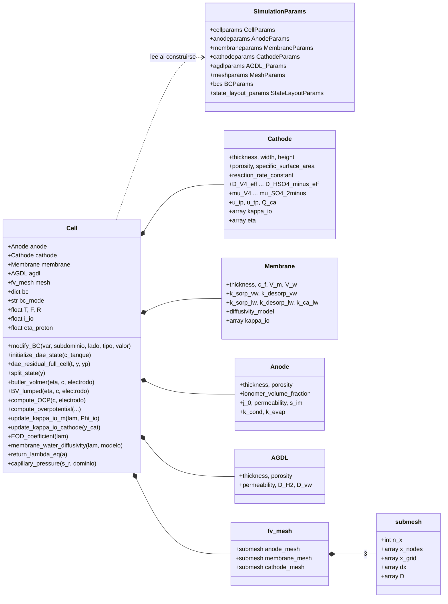
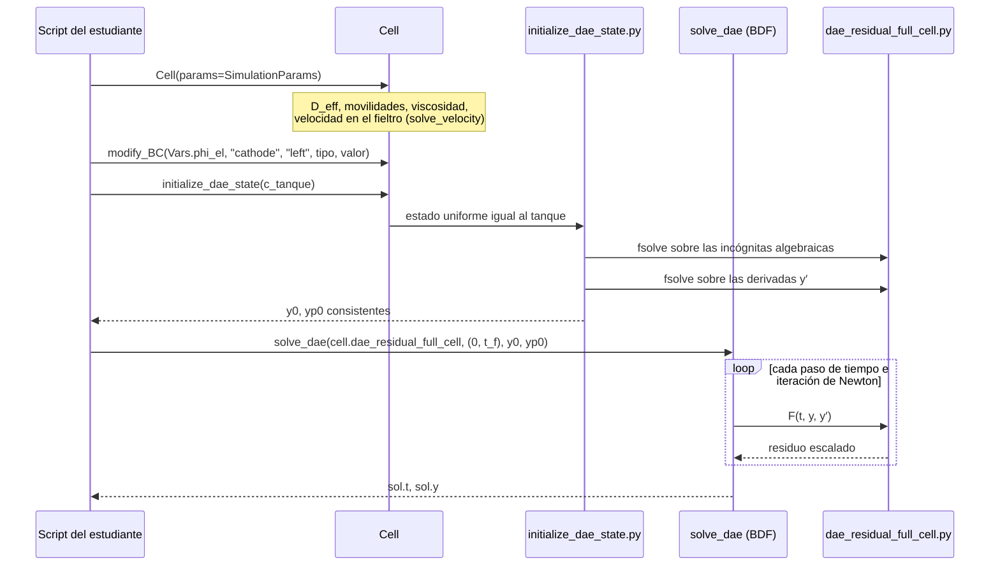
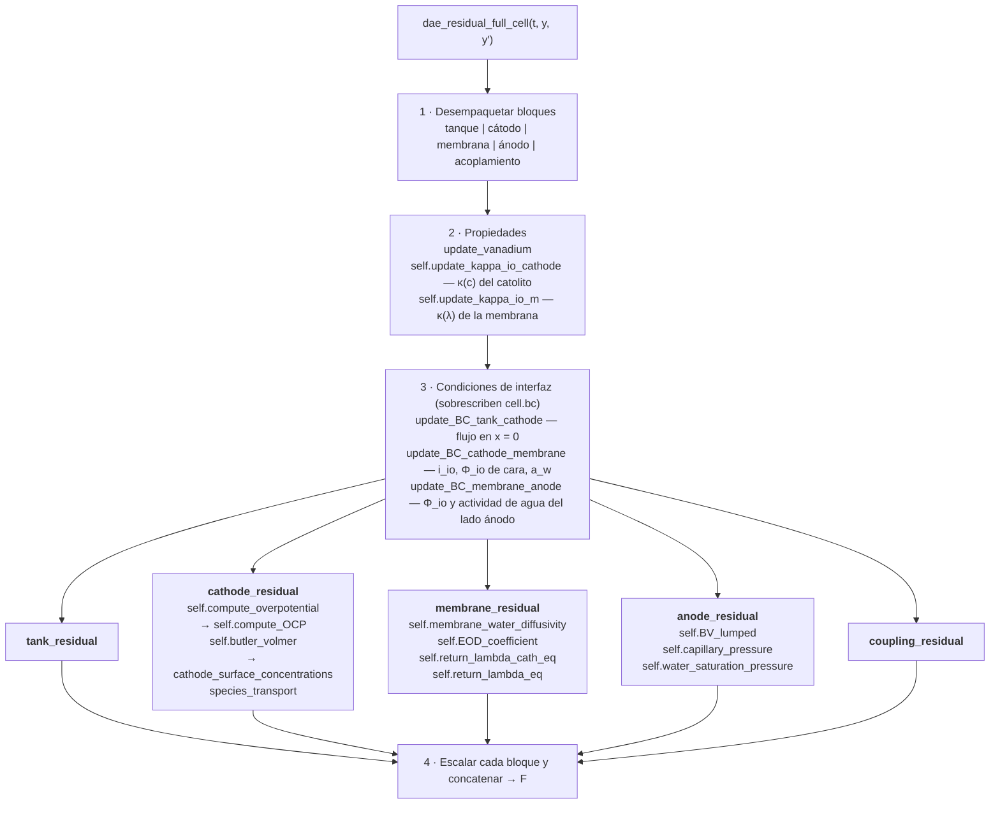
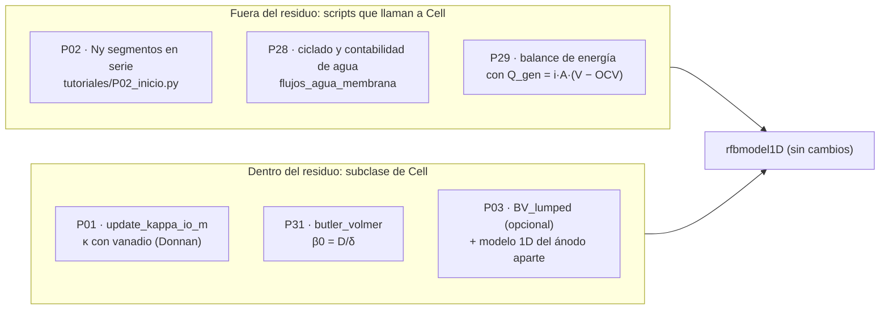

# 3. Arquitectura del código

Esta página responde a una pregunta: **¿en qué archivo y en qué función está implementado cada
fenómeno?** Los diagramas usan notación UML (clases y secuencia) en Mermaid, que GitHub dibuja
directamente.

## 3.1 Clases y archivos

`Cell` es el objeto central. Contiene un objeto por subdominio (propiedades), la malla y las
condiciones de borde. Casi toda la física está en **funciones de módulo** que reciben la celda
como primer argumento (`self`). `Cell` las expone como métodos de una línea; esa es la razón por
la que se pueden reemplazar con una subclase (sección 3.5).



| Archivo | Contenido |
| --- | --- |
| `rfbmodel1D/cells/cell.py` | Clase `Cell`: construcción, condiciones de borde (`modify_BC`, `apply_*_BC`), operador de migración, `split_state` |
| `rfbmodel1D/cells/DAE/dae_residual_full_cell.py` | **Las ecuaciones de gobierno**: un residuo por subdominio y las actualizaciones de interfaz |
| `rfbmodel1D/cells/subdomains/` | `Cathode`, `Membrane`, `Anode`, `AGDL`: contenedores de propiedades |
| `rfbmodel1D/cells/methods/` | Leyes constitutivas y utilidades: κ, D(λ), ξ(λ), isotermas λ(a), p_sat, propiedades efectivas, estado inicial |
| `rfbmodel1D/electrochem/` | Butler–Volmer, OCP (Nernst), sobrepotencial, descomposición de pérdidas |
| `rfbmodel1D/meshes/grid_creation/` | `submesh` (malla de volúmenes finitos en [0, 1]) y `fv_mesh` |
| `rfbmodel1D/parameters/params.py` | Todos los parámetros, tamaños de malla, diseño del vector de estado y condiciones de borde por defecto |
| `rfbmodel1D/post_processing/` | Extracción de perfiles, densidades de corriente, gráficos simples |
| `tutoriales/iiq3843_utils.py` | (Curso) construir, integrar, extraer; no cambia la física |

## 3.2 Secuencia de una simulación



## 3.3 Qué pasa dentro de una evaluación del residuo



Tres consecuencias para quien modifica el modelo:

1. **Las condiciones de interfaz se recalculan en cada llamada.** Cambiar un valor por defecto
   en `params.py` no cambia una condición de interfaz: hay que cambiar la función `update_BC_*`.
2. **Las propiedades son efectos secundarios.** `cell.cathode.eta`, `cell.cathode.kappa_io`,
   `cell.membrane.kappa_io`, `cell.i_io` y `cell.eta_proton` guardan la última evaluación.
3. **Los residuos están escalados** por magnitudes características (100 A/m², 500 mol/m³ de
   vanadio, 3000 mol/m³ de H⁺). Una ecuación nueva necesita su escala.

## 3.4 Mapa fenómeno → código

Las líneas corresponden a `dae_residual_full_cell.py` en esta copia; si cambian, busque por nombre.

| Fenómeno | Archivo | Función (línea) | ¿Se reemplaza con subclase? |
| --- | --- | --- | --- |
| Balance del tanque | `cells/DAE/dae_residual_full_cell.py` | `tank_residual` (295) | No (función de módulo) |
| Nernst–Planck de V(IV), V(V), H⁺, HSO₄⁻ en el fieltro | ídem | `cathode_residual` → `species_transport` (127, 159) | No |
| Disociación HSO₄⁻ ⇌ H⁺ + SO₄²⁻ | ídem | `b_dis` en `cathode_residual` (218) | No |
| Carga en el sólido (Φ_el) y en el electrolito (Φ_io) del cátodo | ídem | `cathode_residual` (258–292) | No |
| Cinética catódica VO²⁺/VO₂⁺ | `electrochem/butler_volmer.py` | `butler_volmer`, `cathode_surface_concentrations` | **Sí**: `Cell.butler_volmer` |
| Sobrepotencial y OCP | `electrochem/compute_overpotential.py`, `compute_OCP.py` | `compute_overpotential`, `compute_OCP` | **Sí** |
| κ del catolito | `cells/methods/update_kappa_io_m.py` | `update_kappa_io_cathode` | **Sí** |
| κ(λ) de la membrana | ídem | `update_kappa_io_m` | **Sí** |
| Agua en la membrana: difusión + arrastre | `cells/DAE/dae_residual_full_cell.py` | `membrane_residual` (328–428) | No |
| D(λ), ξ(λ), isotermas λ(a) | `cells/methods/membrane_water_diffusivity.py`, `EOD_coefficient.py`, `return_lambda_eq.py` | homónimas | **Sí** |
| Ohm en la membrana | `cells/DAE/dae_residual_full_cell.py` | `membrane_residual` (429–465) | No |
| Ánodo: vapor, H₂, saturación, η (concentrado) | ídem | `anode_residual` (468) | No |
| Cinética HOR (lineal) | `electrochem/butler_volmer.py` | `BV_lumped` | **Sí** |
| Pérdida protónica en la ACL (analítica) | `cells/DAE/dae_residual_full_cell.py` | `update_BC_membrane_anode` (734) | No |
| Interfaz cátodo/membrana: i_io, c_H* | ídem | `update_BC_cathode_membrane` (689), `coupling_residual` (596) | No |
| Velocidad en el fieltro, reparto fieltro/canal | `cells/methods/initialize_properties.py` | `solve_velocity` | **Sí** (se llama en `__init__`) |
| Malla y operador de difusión | `meshes/grid_creation/submesh.py` | `submesh` | — |

## 3.5 El patrón de extensión del curso: subclase de `Cell`

El residuo llama a muchas leyes a través de `self` (por ejemplo `self.update_kappa_io_m(...)`).
Si usted define una subclase que redefine ese método, el modelo usa su versión **sin tocar
`rfbmodel1D/`**:

```python
from rfbmodel1D.cells.cell import Cell

class MiCelda(Cell):
    def update_kappa_io_m(self, lambda_w, Phi_io_membrane):
        super().update_kappa_io_m(lambda_w, Phi_io_membrane)   # ley original
        self.membrane.kappa_io = self.membrane.kappa_io * 0.9    # su modificación

cell, y0, yp0 = construir_celda(0.75, "galvanostatico", -500.0, clase=MiCelda)
```

Ventajas: su cambio queda en un archivo propio, el caso base sigue disponible para comparar y
no hay conflictos al actualizar el repositorio. Para ecuaciones que viven en funciones de módulo
(columna "No" de la tabla) hay que editar `dae_residual_full_cell.py`; ver
[05_modificar_el_modelo.md](05_modificar_el_modelo.md).

## 3.6 Condiciones de borde: `cell.bc`

`cell.bc[variable][subdominio][lado]` es un `boundary_condition(type, value)`, con `variable`
un miembro de `Vars` (`Vars.c_v4`, `Vars.phi_io`, `Vars.a`, ...), `subdominio` en
`"cathode"`, `"membrane"`, `"anode"` y `lado` en `"left"`, `"right"`.

| Condición | Quién la fija | Cuándo |
| --- | --- | --- |
| Φ_el en el colector catódico (corriente o voltaje) | usted, con `modify_BC` (o `construir_celda`) | una vez |
| c_i en x = 0 del cátodo (= tanque) | `update_BC_tank_cathode` | cada evaluación |
| c_H y Φ_io en la cara cátodo/membrana | `update_BC_cathode_membrane` | cada evaluación |
| Actividad de agua a_w del lado cátodo de la membrana | `update_BC_cathode_membrane` (vía SOC medio) | cada evaluación |
| Φ_io, a_w y s del lado ánodo de la membrana | `update_BC_membrane_anode` | cada evaluación |
| Humedad y c_H2 en el canal de H₂ | `params.py` (`bcs[Vars.a]["anode"]["right"]`, `bcs[Vars.c_h2]["anode"]["right"]`) | fijas |

## 3.7 Dónde trabaja cada proyecto



Ningún proyecto del alcance mínimo necesita editar `rfbmodel1D/`. Las ampliaciones que agregan
una incógnita nueva (temperatura como estado en P29, c_s como incógnita en P31) sí lo requieren;
siga la lista de la sección 5.4 de [05_modificar_el_modelo.md](05_modificar_el_modelo.md).
