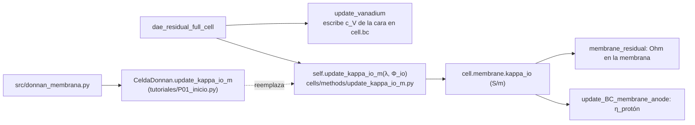

# P01 — Uptake de vanadio en la membrana y conductividad iónica (versión 2, reducida)

**Estudiante:** Francesca De Col · **Supervisor:** Cristóbal Castillo · **Hitos:** EPI 13-11 17:30; CR2 17-11
**Script de inicio:** `tutoriales/P01_inicio.py`

## Pregunta (reducida)

¿Cuánto baja la conductividad iónica de la membrana entre SoC 0,2 y 0,9 por el vanadio absorbido
según el equilibrio Donnan, y cuánto cambia con ello la caída óhmica de la membrana a 500 A/m²?

## Objetivos

1. Programar `src/donnan_membrana.py`: equilibrio Donnan en la cara membrana–electrolito para
   H⁺, VO²⁺, VO₂⁺, HSO₄⁻ y SO₄²⁻, y κ por Nernst–Einstein con las concentraciones dentro de la membrana.
2. Calcular κ(SoC) con y sin vanadio, y el factor f(SoC) = κ_Donnan(SoC)/κ_Donnan(sin vanadio).
3. Aplicar f(SoC) a la κ(λ) del modelo y comparar la caída óhmica de la membrana y el voltaje con la
   base a tres SoC.

**Qué se quitó de la versión 1:** el ciclo completo de carga y descarga, la comparación con la curva
del artículo (pasa a ampliado) y el barrido doble de la Fig. 4 (queda solo la sensibilidad a c_f,
que no requiere simular).

## Entregables

- `src/donnan_membrana.py` y el script que acopla (basado en `P01_inicio.py`), con `README.md`.
- **Fig. 1** c_i,m vs. SoC (cinco especies). **Fig. 2** κ_Donnan(SoC) con y sin vanadio, y f(SoC).
- **Tabla 1** a SoC 0,2, 0,5 y 0,9: ΔΦ_m y V base vs. Donnan, y la fracción de la caída óhmica
  atribuible al vanadio.
- **Fig. 3** (corta) sensibilidad de f(SoC = 0,5) a c_f (0,8 a 1,2 veces el valor base).
- Informe EPI (≤ 8 páginas) y CR2 (4 diapositivas).

## Dónde está su proyecto en el código



| Qué | Dónde |
| --- | --- |
| κ(λ) de la membrana | `rfbmodel1D/cells/methods/update_kappa_io_m.py` → `update_kappa_io_m` |
| Composición del electrolito en la cara | `cell.bc` (lo escribe `update_vanadium` en `dae_residual_full_cell.py`, línea 781); leerla con `composicion_interfaz(cell)` del script |
| Carga fija y difusividades en la membrana | `MembraneParams`: `c_f = 1390 mol/m³`, `D_H_plus = 3,35e-9`, `D_V4 = 5e-12`, `D_V5 = 1,17e-12`, `D_HSO4_minus = 4e-11 m²/s` |
| Caída óhmica de la membrana | `perfiles(cell, y)["phi_io_m"]`: ΔΦ_m = Φ_io[-1] − Φ_io[0] |
| Opción incorporada `vanadium_uptake=True` | **No la use**: falla al inicializar ([problemas conocidos](../06_problemas_conocidos.md)) |

## Paso a paso

**Paso 1 (F1, 2 h).** Instale y corra `python tutoriales/P01_inicio.py`. Debe obtener:

| SoC | V [V] | ΔΦ_m [mV] | κ_m medio [S/m] | c_V4 / c_V5 / c_H en la cara [mol/m³] |
| --- | --- | --- | --- | --- |
| 0,2 | 1,0574 | 13,47 | 4,646 | 817 / 171 / 4984 |
| 0,5 | 1,0967 | 13,56 | 4,617 | 524 / 465 / 4981 |
| 0,9 | 1,1494 | 13,68 | 4,578 | 126 / 866 / 4979 |

Estos son sus casos base (factor = 1).

**Paso 2 (F1, 2 h).** Lea `update_kappa_io_m` y la clase `CeldaDonnan` del script. Entienda por qué
redefinir el método en la subclase basta para que el residuo use su versión ([arquitectura §3.5](../03_arquitectura.md#35-el-patrón-de-extensión-del-curso-subclase-de-cell)).

**Paso 3 (F2, 4 h). Ficha matemática.** Para cada ion i en la solución (s) y en la membrana (m):

```math
c_{i,m} = c_{i,s}\,\exp\!\left(-\frac{z_i F\,\Delta\varphi_D}{RT}\right),
\qquad
\sum_i z_i\,c_{i,m} - c_f = 0,
\qquad
\kappa_D = \frac{F^2}{RT}\sum_i z_i^2\,D_{i,m}\,c_{i,m}
```

Use c_SO4 = (2 c_V4 + c_V5 + c_H − c_HSO4)/2 en la solución, igual que
`update_kappa_io_cathode`. Supuestos a declarar: actividades = concentraciones; c_f por volumen de
membrana hidratada; las D_i,m de `MembraneParams` no dependen de λ.

**Paso 4 (F2, 2 h). Tabla de parámetros** con fuente: c_f, z_i, D_i,m, T = 305,15 K.

**Paso 5 (F3, 6 h). `src/donnan_membrana.py`.** Escriba
`donnan(c_s: dict, c_f, T) -> (dphi_D, c_m: dict)` con `scipy.optimize.brentq` sobre Δφ_D (busque un
intervalo con cambio de signo, por ejemplo ±0,3 V) y `kappa_donnan(c_m, T)`. Pruebas:

- residuo de electroneutralidad < 10⁻⁸ (relativo a c_f);
- con una solución 1:1 de solo H⁺ y HSO₄⁻ (concentración c_s), compare con la solución analítica
  c_H,m = c_f/2 + √(c_f²/4 + c_s²) (sale de c_H,m − c_A,m = c_f y c_H,m · c_A,m = c_s²);
- orden de magnitud: con solo H⁺, κ_D = F²/(RT)·D_H·c_f ≈ 17 S/m a 305 K. Es mayor que la κ(λ)
  del modelo (≈ 4,6 S/m) porque D_H,m no incluye el efecto de λ; **por eso se usa el cociente f**
  y no el valor absoluto.

Haga las Fig. 1 y 2 con SoC de 0,1 a 0,9, usando como composición de la solución la del tanque
(c_V4 = (1 − SoC)·1000, c_V5 = SoC·1000, c_H = 4963, c_HSO4 = 4963·3/5 mol/m³).

**Paso 6 (F3, 4 h). Acoplar.** En `factor_kappa(cell, comp)` del script, construya la solución con
`comp` (cara cátodo/membrana) y devuelva κ_D(comp)/κ_D(comp sin vanadio). Verifique:

- con `factor_kappa` = 1 reproduce la tabla del paso 1 (igual hasta el último dígito);
- el factor está entre 0 y 1 y es continuo en SoC.

**Paso 7 (F4, 4 h). Corridas.** Corra los tres SoC con el factor. Calcule para cada uno
ΔΦ_m,base, ΔΦ_m,Donnan, ΔV y la fracción (ΔΦ_m,Donnan − ΔΦ_m,base)/ΔΦ_m,Donnan (Tabla 1).
Referencia: con un factor 0,8 constante el script da ΔΦ_m = 17,04 mV y V = 1,1209 V a SoC 0,75,
contra 13,63 mV y 1,1247 V sin factor.

**Paso 8 (F4, 4 h). Sensibilidad e interpretación.** Fig. 3 (solo `donnan_membrana.py`, sin
simular). Explique por qué el VO²⁺ (z = 2) se absorbe más que el VO₂⁺ (z = 1) y qué implica para
bajo y alto SoC.

**Paso 9 (F5, 4 h).** Informe y CR2: pregunta y resultado principal en la primera página.

## Verificación

| Prueba | Criterio |
| --- | --- |
| Electroneutralidad en la membrana | residuo relativo < 10⁻⁸ |
| Factor = 1 | resultados idénticos a la base del paso 1 |
| c_V → 0 | f → 1 |
| Corriente | `perfiles(...)["i_io"]` = −500,00 A/m² en todas las corridas |

## Errores frecuentes

Olvidar el signo de z_i; usar concentraciones del electrolito como si fueran de la membrana;
mezclar mol/m³ con mol/L (el modelo usa mol/m³); no recalcular SO₄²⁻ al quitar el vanadio.

## Ampliado (solo si sobra tiempo)

Ciclo de carga y descarga con `tutoriales/02_ciclo_carga_descarga.py` usando `CeldaDonnan`;
comparación con la curva de voltaje de `HVRFB_paper.pdf`. El cruce de vanadio no está en el
modelo (pared de flujo cero en la membrana): no lo intente en este proyecto.
