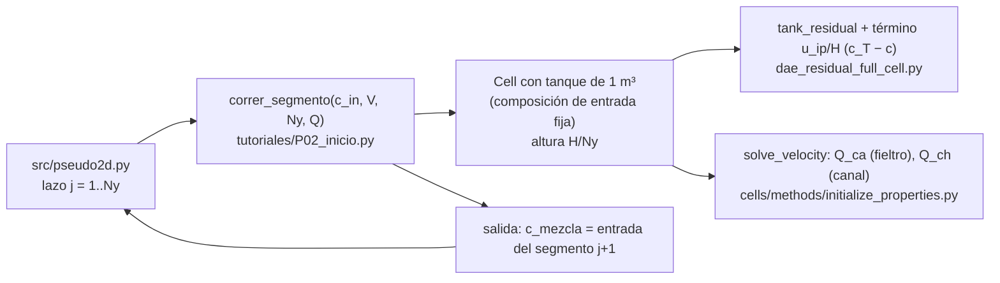

# P02 — Modelo pseudo-2D de una HVRFB a lo largo del canal (versión 2, reducida)

**Estudiante:** Germán Rifo · **Supervisor:** Cristóbal Castillo · **Hitos:** EPI 13-11 17:30; CR2 17-11
**Script de inicio:** `tutoriales/P02_inicio.py`

## Pregunta (reducida)

A voltaje de celda fijo, ¿cuánto se desvía la corriente total de una celda dividida en Ny
segmentos en serie a lo largo del canal respecto del modelo 1D de un solo segmento, y cómo
depende esa desviación del caudal?

## Objetivos

1. Programar el lazo pseudo-2D: Ny segmentos en serie, cada uno resuelto con el modelo 1D completo
   a través del espesor, acoplados por la composición de salida de un segmento, que es la entrada
   del siguiente.
2. Obtener los perfiles a lo largo del canal de la corriente local i(y) y de c_V5(y), verificando
   Faraday en cada segmento y en la celda completa (error < 1 %) y la convergencia en Ny.
3. Barrer el caudal (tres valores) y comparar la corriente total con la del caso Ny = 1.

**Qué se quitó de la versión 1:**

- Las curvas de voltaje vs. tiempo: los segmentos se resuelven hasta estado cuasi-estacionario.
- La búsqueda de V con `brentq` en modo galvanostático: se trabaja a voltaje fijo, que es
  equivalente con colectores conductores. Pasa a ampliado.
- El barrido de la fracción φ que no penetra el electrodo: el modelo ya la calcula a partir de las
  caídas de presión en fieltro y canal (`solve_velocity`); se reporta, no se impone.

## Entregables

- `src/pseudo2d.py` (basado en `P02_inicio.py`) y `README.md`.
- **Fig. 1** i(y) y c_V5(y) para Ny = 8. **Tabla 1** Ny, I_total, error de Faraday por segmento y total.
- **Fig. 2** Convergencia de I_total con Ny = 1, 2, 4, 8.
- **Fig. 3** Desviación (I_total,Ny − I_1D)/I_1D vs. caudal (3 valores) y la fracción φ de cada caudal.
- Informe EPI (≤ 8 páginas) y CR2 (4 diapositivas).

## Dónde está su proyecto en el código



| Qué | Dónde |
| --- | --- |
| Intercambio fieltro–flujo en el plano | `cathode_residual`: `source_term_convection_ip = u_ip (c_T − c)/H` |
| Reparto del caudal entre fieltro y canal | `solve_velocity` → `cell.cathode.Q_ca`, `cell.cathode.u_ip` |
| Altura del fieltro (largo del canal) | `cell.cathode.height` (0,05 m) |
| Flujo difusivo en la cara x = 0 | `update_BC_tank_cathode` (no se guarda; `correr_segmento` lo recalcula) |

**Por qué funciona el truco del tanque grande.** Con V_tanque = 1 m³ la composición del "tanque"
no cambia en 200 s y actúa como la corriente de entrada al segmento. En estado estacionario, el
fieltro de un segmento es un reactor de mezcla: el caudal Q_ca que lo atraviesa sale con la
concentración media del fieltro c̄. Además, el fieltro intercambia especies por difusión con el
canal en la cara x = 0 (flujo N₀). El balance de V(V) del segmento es:

```math
\underbrace{Q_{ca}\,(c_{in} - \bar c)}_{\text{fieltro}} + \underbrace{A_{seg}\,N_0}_{\text{cara } x=0} = -\frac{i\,A_{seg}}{F},
\qquad
c_{mezcla} = \frac{Q_{ca}\,\bar c + Q_{ch}\,c_{in} - A_{seg}\,N_0}{Q}
```

Sin el término de la cara x = 0, el balance queda corto en 8 %; con él cierra al 0,01 %.

## Paso a paso

**Paso 1 (F1, 2 h).** Corra `python tutoriales/P02_inicio.py`. Debe obtener:

```text
Ny = 1: i = -1141.8 A/m2, fracción que no penetra el fieltro = 0.146
  consumo V(V): fieltro 2.729e-05 + cara x=0 2.299e-06 = 2.959e-05 mol/s;  Faraday 2.958e-05 mol/s;  error 0.01 %
  c_V5: entrada 500.0, fieltro 457.4, salida mezclada 460.5 mol/m3
```

(V = 1,05 V, SoC de entrada 0,5, 45 ml/min, 32 °C).

**Paso 2 (F1, 2 h).** Lea `correr_segmento` línea por línea y el término `source_term_convection_ip`
en `cathode_residual`. Escriba en una frase qué representa cada término del balance anterior.

**Paso 3 (F2, 4 h). Ficha matemática.** Balance de especie por segmento, condición de voltaje
común, definición de i(y) y de I_total = Σ i_j A_seg. Supuestos: estado cuasi-estacionario por
segmento; canal sin reacción; mezcla completa a la salida de cada segmento.

**Paso 4 (F2, 2 h). Casos.** Ny ∈ {1, 2, 4, 8}; caudales 22,5, 45 y 90 ml/min; V = 1,05 V;
SoC de entrada 0,5. Tabla de parámetros con fuentes (geometría en `CathodeParams`).

**Paso 5 (F3, 6 h). Lazo.** Complete el `TODO` del script:

```python
c = c_in.copy(); I_total = 0.0; tabla = []
for j in range(Ny):
    r = correr_segmento(c, V, Ny, Q_ml_min=Q)
    I_total += r["i"] * r["A_seg"]
    tabla.append((j, r["i"], r["c_mezcla"][1], r["balance"]["total"], r["balance"]["faraday"]))
    c = r["c_mezcla"]
```

Cada segmento tarda unos 10 s: Ny = 8 son unos 80 s.

**Paso 6 (F3, 4 h). Verificación.** Faraday por segmento y total (< 1 %); Ny = 1 debe dar el
mismo resultado que el paso 1; I_total debe converger al aumentar Ny (Fig. 2).

**Paso 7 (F4, 4 h).** Perfiles i(y), c_V5(y) con Ny = 8 (Fig. 1).

**Paso 8 (F4, 4 h).** Barrido de caudal (Fig. 3). Interprete: a caudal alto la composición se
vuelve uniforme y la desviación debe tender a cero. Compare la desviación con el error de
validación del modelo base informado en `HVRFB_paper.pdf`.

**Paso 9 (F5, 4 h).** Informe y CR2.

## Verificación

| Prueba | Criterio |
| --- | --- |
| Faraday por segmento | \|total − faraday\|/\|faraday\| < 1 % |
| Ny = 1 | i = −1141,8 A/m² en el caso del paso 1 |
| Caudal muy alto (por ejemplo 500 ml/min) | i(y) casi uniforme |
| Estado cuasi-estacionario | c_V5 de salida a 150 s y a 200 s difieren < 0,1 mol/m³ |

## Errores frecuentes

No convertir ml/min a m³/s (`configurar` lo hace); comparar Ny distintos con distinto voltaje;
olvidar el término de la cara x = 0 en el balance; usar `c_fieltro` en vez de `c_mezcla` como entrada
del segmento siguiente.

## Ampliado (solo si sobra tiempo)

Operación galvanostática: busque V tal que I_total = I con `scipy.optimize.brentq` sobre el lazo.
Potencia de bombeo con la caída de presión de `solve_velocity`.
