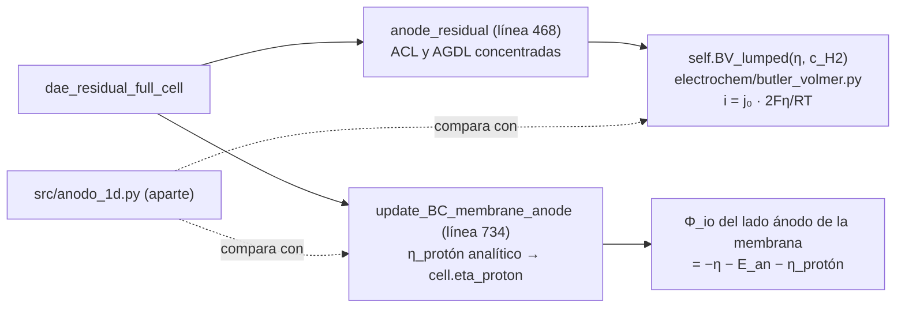

# P03 — Resistencias de transporte en la AGDL y la ACL del ánodo (versión 2, reducida)

**Estudiante:** Martín Rebolledo · **Supervisor:** Cristóbal Castillo · **Hitos:** EPI 13-11 17:30; CR2 17-11
**Script de inicio:** `tutoriales/P03_inicio.py`

## Pregunta (reducida)

¿Cómo cambian la pérdida cinética y la pérdida por conducción protónica del ánodo con la carga de
Pt (vía j₀) y con el espesor de la ACL, y cuánto agrega la difusión de H₂ en la AGDL?

## Objetivos

1. Con el ánodo concentrado que ya trae el modelo, barrer j₀ (proxy de la carga de Pt) y el espesor
   de la ACL, separando η_act y η_protón.
2. Programar `src/anodo_1d.py`: un modelo 1D **estacionario e independiente** de la ACL
   (conducción protónica + cinética) con difusión de H₂ en la AGDL, y verificarlo contra la
   solución analítica que usa el código.
3. Comparar la pérdida anódica total del modelo 1D con la del modelo concentrado para tres cargas
   de Pt, con y sin resistencia de la AGDL.

**Qué se quitó de la versión 1:** reemplazar el ánodo dentro del sistema DAE de la celda (pasa a
ampliado). El modelo 1D se resuelve aparte, a la corriente que entrega la celda.

## Entregables

- `src/anodo_1d.py` y el script de barridos (basado en `P03_inicio.py`), con `README.md`.
- **Fig. 1** η(z) y j(z) en la ACL y c_H2 en la AGDL (modelo 1D) para el caso base.
- **Tabla 1** Verificación: ∫ j dz vs. I, flujo de H₂ vs. I/(2F), y η_protón 1D vs. fórmula analítica.
- **Fig. 2** Pérdida anódica vs. j₀/j₀,base para dos espesores de ACL (modelo concentrado y 1D).
- **Fig. 3** Pérdida con y sin resistencia de la AGDL.
- Informe EPI (≤ 8 páginas) y CR2 (4 diapositivas).

## Dónde está su proyecto en el código



| Qué | Dónde |
| --- | --- |
| η de activación (incógnita algebraica) | `anode_residual`, `res_view[:, 3] = BV + self.i_io`; se lee en `perfiles(...)["anodo"]["eta_acl"]` |
| η_protón | `update_BC_membrane_anode`; se lee en `perfiles(...)["anodo"]["eta_proton"]`; copia comentada en `eta_proton_analitico` del script |
| Cinética HOR | `BV_lumped` en `rfbmodel1D/electrochem/butler_volmer.py` |
| H₂ en ACL, AGDL y canal | `anode_residual`, `res_view[:, 1]` y `res_view[:, 5]`; `c_H2` del canal = 42 mol/m³ en `params.py` |
| Parámetros | `AnodeParams`: `j_0 = 12615 A/m²`, `thickness = 19 µm`, `ionomer_volume_fraction = 0,2`, `porosity = 0,4`; `agdlparams`: `thickness = 171 µm`, `porosity = 0,6` |

## La referencia analítica que su modelo 1D debe recuperar

Sea z ∈ [0, L] la coordenada en la ACL, con z = 0 en la cara con la AGDL y z = L en la cara
con la membrana. La fase electrónica está a potencial cero, i_e(z) es la corriente protónica
hacia la membrana y la cinética es lineal, j_v = A_v η:

```math
\frac{di_e}{dz} = j_v = A_v\,\eta,
\qquad
i_e = \sigma_{\mathrm{eff}}\frac{d\eta}{dz},
\qquad
i_e(0) = 0,\quad i_e(L) = I
```

Esto da η″ = c²η con c² = A_v/σ_eff, cuya solución es η(z) = I cosh(cz)/(σ_eff c sinh cL). La
pérdida en la cara de la membrana se separa en una parte cinética uniforme más una protónica:

```math
\eta(L) = \underbrace{\frac{I}{A_v L}}_{\eta_{cin}} + \underbrace{\frac{I}{\sigma_{\mathrm{eff}}\,c}\left[\coth(cL) - \frac{1}{cL}\right]}_{\eta_{prot\acute{o}n}}
```

El segundo término es exactamente el que calcula `update_BC_membrane_anode`, con
σ_eff = κ_m · ε_ionómero^1,5 y A_v L = 2 j₀ · n f (el código usa 2·j₀ en esta línea, mientras
`BV_lumped` usa j₀). Identifique esa diferencia de un factor 2 y discútala en el informe; su modelo
1D debe reproducir `cell.eta_proton` al usar la misma A_v que la fórmula.

## Paso a paso

**Paso 1 (F1, 2 h).** Corra `python tutoriales/P03_inicio.py` (unos 80 s). Debe obtener
(500 A/m², SoC 0,75):

| j₀/j₀,base | L_ACL | η_act [mV] | η_protón [mV] | V [V] |
| --- | --- | --- | --- | --- |
| 1 | 19 µm | 0,521 | 2,095 | 1,1247 |
| 1 | 57 µm | 0,521 | 3,869 | 1,1227 |
| 0,1 | 19 µm | 5,211 | 4,893 | 1,1172 |
| 0,1 | 57 µm | 5,211 | 10,454 | 1,1114 |
| 0,01 | 19 µm | 52,109 | 6,740 | 1,0684 |
| 0,01 | 57 µm | 52,109 | 18,861 | 1,0561 |

y la columna "fórmula" igual a η_protón: esa es su referencia.

**Paso 2 (F1, 2 h).** Lea `anode_residual` y `update_BC_membrane_anode`. Anote en una tabla qué
variable del modelo corresponde a cada símbolo de las ecuaciones de arriba.

**Paso 3 (F2, 4 h). Ficha matemática.** Las ecuaciones de arriba, más la AGDL estacionaria:
N_H2 = I/(2F) = D_eff (c_canal − c_int)/L_AGDL con D_eff = D ε^1,5, y cinética dependiente de c_H2
(j_v ∝ c_H2/c_ref). Defina cómo pasa de carga de Pt a j₀: j₀ = i₀,Pt · ECSA · L_Pt, y declare la carga
base que corresponde a j₀ = 12 615 A/m² (tómela del artículo base o de su CR1).

**Paso 4 (F2, 2 h).** Tabla de parámetros con fuentes (los de la tabla de arriba, más D_H2 y la
ECSA que elija).

**Paso 5 (F3, 6 h). `src/anodo_1d.py`.** Volúmenes finitos en z (50 volúmenes bastan), incógnita
η en cada volumen, sistema no lineal resuelto con `scipy.optimize.fsolve` (o `solve_bvp`). Funciones
sugeridas: `resolver_acl(I, j0, L, sigma_eff, c_H2)` → (z, η, j), y
`agdl(I, D_eff, L_AGDL, c_canal)` → c_int.

**Paso 6 (F3, 4 h). Verificación (Tabla 1).** ∫ j dz = I (< 1 %); flujo de H₂ en la entrada de la AGDL
= I/(2F) (< 1 %); con cinética lineal y c_H2 uniforme, η(L) − η_cin = η_protón analítico (< 1 %);
malla 50 vs. 100 volúmenes.

**Paso 7 (F4, 4 h).** Barra j₀ (5 valores) y L_ACL (2 valores) con el modelo 1D, a la corriente y
κ_m de la celda (`perfiles(...)["kappa_m"][-1]`). Fig. 2 contra el modelo concentrado del paso 1.

**Paso 8 (F4, 4 h).** Con y sin resistencia de la AGDL (Fig. 3). Interprete con c_int/c_canal: en
el caso base el modelo concentrado da c_H2,ACL = 41,98 contra 42 mol/m³ en el canal.

**Paso 9 (F5, 4 h).** Informe y CR2. Enuncie la brecha en una frase y muéstrela con la Fig. 3.

## Verificación

| Prueba | Criterio |
| --- | --- |
| Conservación de carga en la ACL | \|∫ j dz − I\|/I < 1 % |
| H₂ en la AGDL | \|N_H2 − I/(2F)\|/(I/(2F)) < 1 % |
| Límite analítico | η_protón 1D = fórmula del código (< 1 %) |
| L_AGDL → 0 | c_int → c_canal |

## Errores frecuentes

Mezclar j₀ geométrica (A/m² de electrodo) con volumétrica (A/m³); usar j₀ por área de Pt sin
convertir por la carga; dar condiciones de borde incompatibles (fijar η en ambas caras); olvidar el
factor ε^1,5 en σ_eff.

## Ampliado (solo si sobra tiempo)

Butler–Volmer completo en el ánodo concentrado mediante la subclase `CeldaBVAnodo` del script
(redefine `BV_lumped`). Referencia: con αa = αc = 0,5, el script de prueba del equipo docente dio
η_act = 1,05 mV (contra 0,52 mV lineal), por la diferencia de n entre ambas formas: revísela.
