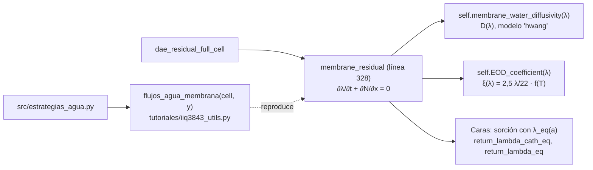

# P28 — Transporte transitorio de agua en la membrana y desbalance hídrico (versión 2, reducida)

**Estudiante:** Jacinta Carcelén · **Supervisor:** Cristóbal Castillo · **Hitos:** EPI 13-11 17:30; CR2 17-11
**Script de inicio:** `tutoriales/P28_inicio.py`

**Alcance confirmado:** el modelo de agua ya está en el código y en el artículo. Su aporte es el
ciclado, la separación por mecanismo y una estrategia de reposición, no la reproducción del
artículo (era el pendiente de la versión 1).

## Pregunta (reducida)

¿Cuánta agua gana o pierde el catolito por ciclo de carga y descarga, separada en difusión y
arrastre electro-osmótico, y cuánta agua habría que reponer al día en una instalación del norte de Chile?

## Objetivos

1. Separar el flujo de agua en la membrana en difusión y arrastre durante la carga y la
   descarga, cerrando el balance de agua de la membrana con error < 1 %.
2. Acumular la transferencia neta de agua al catolito en tres ciclos y expresarla como volumen.
3. Evaluar una estrategia de reposición por umbral (a posteriori) y el efecto de la densidad de
   corriente (250, 500 y 1000 A/m²) sobre el agua repuesta por día.

**Qué se quitó de la versión 1:** la segunda estrategia como corrida aparte (el barrido de corriente
cumple ese papel) y el acoplamiento del cambio de volumen con la concentración de vanadio. El modelo
mantiene constante el volumen del tanque (dV/dt = 0 en `tank_residual`), así que el desbalance se
contabiliza después de simular; declárelo como limitación.

## Entregables

- `src/estrategias_agua.py` y el script de ciclado (basado en `P28_inicio.py`), con `README.md`.
- **Fig. 1** Flujo por difusión y por arrastre vs. tiempo en un ciclo. **Tabla 1** Balance de agua
  de la membrana por tramo (error).
- **Fig. 2** Agua acumulada en el catolito vs. número de ciclos (3 ciclos) para 3 densidades de corriente.
- **Tabla 2** Agua repuesta por día y su costo en un caso del norte de Chile (supuestos citados).
- Informe EPI (≤ 8 páginas) y CR2 (4 diapositivas).

## Dónde está su proyecto en el código



| Qué | Dónde |
| --- | --- |
| Ecuación de λ y flujos en las caras | `membrane_residual`, líneas 346–428 |
| Separación en difusión y arrastre | `flujos_agua_membrana` devuelve `N_dif`, `N_eod` (caras interiores), `N_cat`, `N_an` (bordes) en mol H₂O/m²/s |
| Condición del lado cátodo | actividad de agua del catolito según SOC: `return_water_activity_cathode` |
| Condición del lado ánodo | a = RH + 2 s_r desde el ánodo: `update_BC_membrane_anode` |
| Cambio de corriente entre tramos | `cambiar_operacion(cell, y, "galvanostatico", j)` |

Signos: los flujos son positivos hacia el ánodo (+x). `N_cat > 0` significa que entra agua a la
membrana desde el catolito, es decir, que el catolito pierde agua.

## Paso a paso

**Paso 1 (F1, 2 h).** Corra `python tutoriales/P28_inicio.py` (unos 20 s). Debe obtener
(±500 A/m², 30 + 30 min, SoC inicial 0,5):

```text
carga: ΔW interior = -7.1077e-02 mol/m2, ∫(N_1 − N_N)dt = -7.1081e-02 mol/m2, error = 0.01 %
descarga: ΔW interior = -1.7762e-01 mol/m2, ∫(N_1 − N_N)dt = -1.7665e-01 mol/m2, error = 0.55 %
Agua neta ganada por el catolito en 1 ciclo: 5.351e-02 mol = 0.968 mL (área 25 cm2)
```

**Paso 2 (F1, 2 h).** Lea `membrane_residual` y `flujos_agua_membrana`. Verifique a mano, en una
cara, que N = −D Δλ/Δx + ξ i/(F c_f).

**Paso 3 (F2, 4 h). Ficha matemática.** Balance de agua de la membrana, definición de agua
ganada por el catolito y conversión a volumen (V̄_w = 1,809 × 10⁻⁵ m³/mol), más el volumen relativo
ΔV/V₀ con V₀ = 0,5 L. Por qué se integra en la primera cara interior y no en el borde: ver
[problemas conocidos](../06_problemas_conocidos.md).

**Paso 4 (F2, 2 h). Casos:** 3 ciclos; J = 250, 500 y 1000 A/m²; umbral θ = 1 % y 5 %. Para el
costo, use un precio de agua desmineralizada o desalada en el norte de Chile con su fuente.

**Paso 5 (F3, 6 h).** Envuelva el lazo de carga y descarga en una función `ciclar(J, n)` que
devuelva t, el agua acumulada y los flujos por mecanismo. Escriba `src/estrategias_agua.py`: con
V(t) = V₀ + V̄_w · (agua ganada), cada vez que |V − V₀|/V₀ > θ se repone (o retira) hasta V₀ y se
suma el volumen movido.

**Paso 6 (F3, 4 h). Verificación (Tabla 1):** balance de la membrana < 1 % por tramo; sin
estrategia, el agua acumulada debe coincidir con el script de inicio; con i = 0 (tramo de reposo
con `cambiar_operacion(cell, y, "galvanostatico", 0.0)`) el arrastre debe ser cero.

**Paso 7 (F4, 4 h).** Corra los tres ciclos para las tres corrientes (Fig. 1 y 2). Identifique qué
mecanismo domina en carga y cuál en descarga.

**Paso 8 (F4, 4 h).** Aplique la estrategia y calcule agua por día suponiendo un número de ciclos
diarios declarado; Tabla 2 con el costo.

**Paso 9 (F5, 4 h).** Informe y CR2.

## Verificación

| Prueba | Criterio |
| --- | --- |
| Balance de agua de la membrana | error < 1 % con los pasos del solver (no use `n_salidas`) |
| i = 0 | N_eod = 0 |
| Reproducibilidad | 1 ciclo a 500 A/m² = 0,968 mL ganados por el catolito |

## Errores frecuentes

Confundir mol y volumen de agua; olvidar el cambio de signo del arrastre entre carga y descarga;
mirar un solo ciclo; integrar flujos con salidas interpoladas; usar el flujo de borde `N_cat`
directamente en la integral (es muy rígido: use la cara interior, como el script).

## Ampliado (solo si sobra tiempo)

Ciclos más largos (2 h por tramo); efecto de la humedad del H₂ del canal
(`bcs[Vars.a]["anode"]["right"]` en `params.py`, hoy 1).
