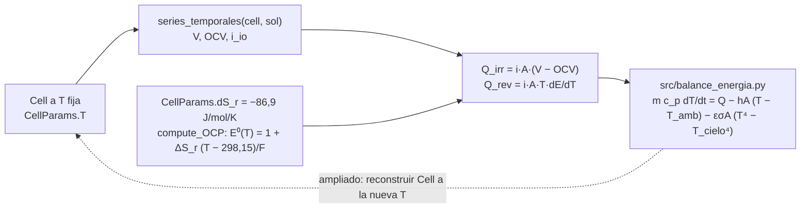

# P29 — Balance térmico y riesgo de precipitación de V₂O₅ en Atacama (versión 2, reducida)

**Estudiante:** Francisco Navarro · **Supervisor:** Cristóbal Castillo · **Hitos:** EPI 13-11 17:30; CR2 17-11
**Script de inicio:** `tutoriales/P29_inicio.py`

## Pregunta (reducida)

Para un stack de HVRFB que cicla a 500 A/m² bajo el ciclo diario de temperatura de Calama, ¿supera
el electrolito 40 °C con solo enfriamiento pasivo (convección y radiación), y qué coeficiente hA
lo evita?

## Objetivos

1. Calcular con el modelo el calor generado por celda, irreversible y reversible, en carga y descarga.
2. Programar `src/balance_energia.py`: un balance de energía concentrado del electrolito (tanque +
   celdas) con pérdidas por convección y radiación y T_amb(t) de una estación de Atacama, y
   verificarlo contra el límite adiabático.
3. Barrer la densidad de corriente (3 valores) y hA (4 valores) y contar las horas sobre 40 °C.

**Qué se quitó o cambió respecto de la versión 1:**

- **Acoplamiento en una dirección.** El modelo es isotérmico (T se fija al construir la celda); el
  calor se calcula a T fija y la temperatura se integra aparte. El acoplamiento en dos direcciones
  pasa a ampliado.
- **El calor reversible entra al alcance mínimo**, porque el modelo ya trae su coeficiente
  entrópico y domina el balance (ver paso 3).

## Entregables

- `src/balance_energia.py` y el script de ciclos (basado en `P29_inicio.py`), con `README.md`.
- **Fig. 1** T_amb(t) de la estación elegida (con fuente). **Fig. 2** Q_irr, Q_rev y T del
  electrolito vs. tiempo en un día de ciclos.
- **Tabla 1** Verificación: cierre del balance de energía y límite adiabático.
- **Fig. 3** Horas sobre 40 °C vs. hA para tres corrientes. **Tabla 2** hA mínimo por corriente.
- Informe EPI (≤ 8 páginas) y CR2 (4 diapositivas).

## Dónde está su proyecto en el código



| Qué | Dónde |
| --- | --- |
| Voltaje de celda | `voltaje(cell, y)` = Φ_el en el colector catódico (`iiq3843_utils.py`) |
| OCV con la composición del tanque | `ocv(cell, y)`, usa `compute_OCP` (`rfbmodel1D/electrochem/compute_OCP.py`) |
| Dependencia del OCP con T | `compute_OCP`: `Ec0 = 1 + dS_r/F (T − 298,15)` → dE/dT = ΔS_r/F = −0,90 mV/K |
| Temperatura de la celda | `CellParams.T` (322 K por defecto; los tutoriales usan 32 °C) |
| Ciclos | `cambiar_operacion` (ver `tutoriales/02_ciclo_carga_descarga.py`) |

## Paso a paso

**Paso 1 (F1, 2 h).** Corra `python tutoriales/P29_inicio.py` (unos 20 s). Debe obtener:

```text
j = -500 A/m2: V 1.1317→1.1196 V, OCV 1.1598→1.1534 V, Q_gen 0.0352→0.0422 W/celda
j = +500 A/m2: V 1.1804→1.1925 V, OCV 1.1534→1.1598 V, Q_gen 0.0337→0.0408 W/celda
Energía disipada en el ciclo: 1.66 Wh (stack de 40 celdas)
```

**Paso 2 (F1, 2 h).** Ubique en el código el OCP y su dependencia con T, y la fórmula de Q_gen en el
script. Compruebe el signo: Q_irr > 0 en carga y en descarga.

**Paso 3 (F2, 4 h). Ficha matemática.** Con la convención del modelo (i_io < 0 en descarga):

```math
Q_{irr} = i\,A\,(V - E_{ocv}),
\qquad
Q_{rev} = i\,A\,T\,\frac{dE_{ocv}}{dT} = i\,A\,T\,\frac{\Delta S_r}{F},
\qquad
m c_p \frac{dT}{dt} = N\,(Q_{irr} + Q_{rev}) - hA\,(T - T_{amb}) - \varepsilon\sigma A_{ext}\,(T^4 - T_{cielo}^4)
```

Orden de magnitud a 500 A/m² y 25 cm²: Q_rev = 500 × 0,0025 × 305 × 9,0 × 10⁻⁴ ≈ 0,34 W por celda
(exotérmico en descarga, endotérmico en carga), contra Q_irr ≈ 0,04 W. Q_rev se cancela en un
ciclo completo, pero define cuándo se calienta el electrolito. Límite adiabático:
ΔT = N Q t/(m c_p). Tiempo característico: τ = m c_p/(hA).

**Paso 4 (F2, 2 h). Caso y datos.** T_amb(t) horaria de una estación SINCA de Calama (con fuente y
fecha); número de celdas, volumen de electrolito, c_p y densidad, área exterior y ε. Todo en una
tabla con fuente o marcado como supuesto.

**Paso 5 (F3, 6 h). `src/balance_energia.py`.** Complete `T_amb(t)` y `balance_energia(t, T, ...)`
en el script (hoy devuelven valores constantes) e integre con `solve_ivp`. Interpole Q(t) de la
simulación electroquímica. Para un día completo, repita el ciclo del modelo (o use su
promedio por tramo, declarándolo).

**Paso 6 (F3, 4 h). Verificación (Tabla 1).**

- Adiabático (hA = 0, ε = 0) con Q constante: T(t) = T₀ + N Q t/(m c_p) (< 1 %).
- Q = 0: T sigue a T_amb con retardo ~ τ.
- Cierre del balance: ∫(Q − pérdidas) dt = m c_p ΔT (< 1 %).

**Paso 7 (F4, 4 h).** Un día de ciclos a 500 A/m² (Fig. 2) y horas sobre 40 °C.

**Paso 8 (F4, 4 h).** Barrido de corriente (250, 500, 1000 A/m²) y de hA (Fig. 3, Tabla 2).
Q_irr crece con la corriente: recalcúlelo con el modelo para cada corriente.

**Paso 9 (F5, 4 h).** Abra el informe y la CR2 con la respuesta: "sí/no basta el enfriamiento
pasivo, bajo estas condiciones".

## Verificación

| Prueba | Criterio |
| --- | --- |
| Límite adiabático | error < 1 % |
| Cierre de energía | error < 1 % |
| Q = 0 | T → T_amb con retardo τ |
| Q_irr | > 0 en carga y en descarga |

## Errores frecuentes

Mezclar K con °C en la radiación; usar la temperatura media diaria en vez de la máxima; olvidar
el signo de Q_rev (cambia entre carga y descarga); usar el volumen del tanque de laboratorio
(0,5 L) para un stack sin escalarlo.

## Ampliado (solo si sobra tiempo)

Acoplamiento en dos direcciones: cada hora simulada, construya una celda nueva con
`configurar(T_C=T_actual)` y continúe desde la composición del tanque. Radiación solar absorbida
por el tanque (coordine la forma de G(t) con P10 y P34).
