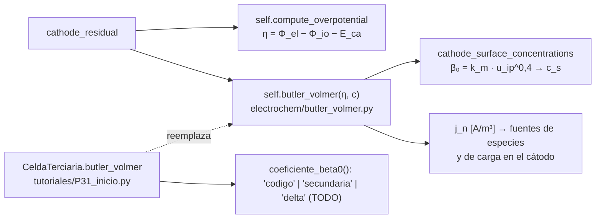

# P31 — Distribución de corriente terciaria en una HVRFB (versión 2, reducida)

**Estudiante:** Sophie Mariné · **Supervisor:** Cristóbal Castillo · **Hitos:** EPI 13-11 17:30; CR2 17-11
**Script de inicio:** `tutoriales/P31_inicio.py`

**Objetivos definidos por el equipo docente (29-10-2026).** Era el pendiente de la versión 1:
el proyecto se acota a la distribución terciaria 1D a través del espesor del cátodo; los pulsos
y el CFD de canales quedan fuera.

## Hallazgo que cambia el proyecto

rfbmodel1D **ya incluye** la limitación por transferencia de masa en la superficie de las fibras.
`cathode_surface_concentrations` (`rfbmodel1D/electrochem/butler_volmer.py`) calcula c_s con un
coeficiente β₀ = k_m · u_ip^0,4 (You et al., 2009). En la corrida base, β₀ = 3,03 × 10⁻⁵ m/s, que
con D_V5,eff = 3,55 × 10⁻¹⁰ m²/s equivale a una capa límite δ = D/β₀ ≈ 12 µm. Su proyecto ya no
implementa la distribución terciaria desde cero: la expone, la parametriza con δ y mide su efecto.

## Pregunta (reducida)

¿Cuánto cambian la distribución de corriente j(x) a través del cátodo y el sobrepotencial al pasar
del límite secundario (sin limitación de masa) a una capa límite de espesor δ, y desde qué δ esa
pérdida supera 10 mV?

## Objetivos

1. Documentar la formulación terciaria del código (ecuaciones de You et al.) y reproducir la base
   con una subclase de `Cell` (ya hecho en el script de inicio).
2. Implementar el modo k_m = D/δ y comparar el límite secundario, la correlación del código y δ
   = 10, 50, 200 y 500 µm: j(x), η(x) y voltaje.
3. Barrer δ para dos corrientes (500 y 1000 A/m²) y dos SoC (0,75 y 0,2) y calcular el
   sobrepotencial de transferencia de masa η_tm = V_secundaria − V_terciaria en descarga; interpretar con j/j_lim.

**Qué se quitó de la versión 1:** la distribución primaria y los pulsos de corriente o caudal (pasan
a ampliado). El voltaje vs. tiempo se reemplaza por corridas cortas de 300 s.

## Entregables

- `src/corriente_terciaria.py` (basado en `P31_inicio.py`) y `README.md`.
- **Fig. 1** j(x) y η(x): secundaria, código y cuatro valores de δ (500 A/m², SoC 0,75).
- **Tabla 1** Verificación: ∫ j dx vs. i, máx |j|/j_lim y límite δ → 0.
- **Fig. 2** η_tm vs. δ para dos corrientes y dos SoC.
- Informe EPI (≤ 8 páginas) y CR2 (4 diapositivas). Defina en el informe cada nivel (primario,
  secundario, terciario) con una ecuación y una figura, como pidió el panel.

## Dónde está su proyecto en el código



## Formulación del código

Para la reacción VO²⁺ + H₂O ⇌ VO₂⁺ + 2H⁺ + e⁻, con concentraciones de seno c y de superficie c^s,
el flujo hacia la fibra iguala la velocidad de reacción. Definiendo los números de Damköhler

```math
\Psi_3 = \frac{k}{\beta_0}\left(\frac{c_{V5}}{c_{V4}}\right)^{\alpha} c_H^{2-2\alpha} e^{(1-\alpha) f\eta},
\qquad
\Psi_4 = \frac{k}{\beta_0}\left(\frac{c_{V4}}{c_{V5}}\right)^{1-\alpha} c_H^{2-2\alpha} e^{-\alpha f\eta}
```

las concentraciones de superficie son

```math
c^s_{V4} = \frac{\Psi_4 c_{V5} + (1+\Psi_4) c_{V4}}{1 + \Psi_3 + \Psi_4},
\qquad
c^s_{V5} = \frac{\Psi_3 c_{V4} + (1+\Psi_3) c_{V5}}{1 + \Psi_3 + \Psi_4}
```

y entran a Butler–Volmer ([docs/04 §4.3](../04_ecuaciones.md#43-cátodo-fieltro-de-carbono-cathode_residual-línea-127)).
Si β₀ → ∞, Ψ → 0 y c^s → c (límite secundario). La corriente límite local en descarga es
j_lim = a F β₀ c_V5.

## Paso a paso

**Paso 1 (F1, 2 h).** Corra `python tutoriales/P31_inicio.py` (unos 15 s). Debe obtener
(−500 A/m², SoC 0,75):

```text
modo codigo    : V = 1.12466 V  η(colector) =  -7.622 mV  ∫j dx =  -500.00 A/m2  β0 = 3.028e-05 m/s  max |j|/j_lim = 0.011
modo secundaria: V = 1.12491 V  η(colector) =  -7.223 mV  ∫j dx =  -500.00 A/m2  β0 = 1.000e+12 m/s  max |j|/j_lim = 0.000
```

El modo "codigo" debe coincidir exactamente con la celda sin subclase: es su prueba de que el
enganche no cambia nada.

**Paso 2 (F1, 2 h).** Lea `butler_volmer.py` y la clase `CeldaTerciaria`. Escriba qué términos de
las ecuaciones de arriba corresponden a cada línea.

**Paso 3 (F2, 4 h). Ficha matemática.** Las ecuaciones de arriba; k_m = D/δ; j_lim; el número de
Damköhler Da = k/β₀ como cociente de velocidades de reacción y de transporte.

**Paso 4 (F2, 2 h). Parámetros.** D (justifique cuál: D_V5,eff o D_V5 sin corregir), rango de δ
con fuente o como supuesto declarado, corrientes y SoC.

**Paso 5 (F3, 6 h). Modo "delta".** En `coeficiente_beta0`, devuelva D/δ. Agregue al script el
barrido sobre `CeldaTerciaria.delta`. Use una celda por corrida, con `configurar` antes de cada
`construir_celda`.

**Paso 6 (F3, 4 h). Verificación (Tabla 1).** ∫ j dx = i (< 1 %); |j| < j_lim en todos los nodos;
δ → 0 recupera el límite secundario; malla NC = 100 vs. 200.

**Paso 7 (F4, 4 h).** Fig. 1. Explique por qué la corriente se concentra junto al colector y cómo
cambia esa concentración con δ (en el script, j en el colector / j medio = 5,8 con el código
y 6,4 en el límite secundario).

**Paso 8 (F4, 4 h).** Barrido δ × corriente × SoC (16 corridas de unos 15 s) y Fig. 2. A bajo SoC en
descarga, c_V5 es menor y j_lim baja: espere un efecto mayor.

**Paso 9 (F5, 4 h).** Informe y CR2.

## Verificación

| Prueba | Criterio |
| --- | --- |
| Modo "codigo" | idéntico a `Cell` (V = 1,12466 V en el caso del paso 1) |
| Conservación de carga | \|∫ j dx − i\|/\|i\| < 1 % |
| Corriente límite | máx \|j\|/j_lim < 1 |
| δ → 0 | V → V_secundaria |

## Errores frecuentes

Mezclar j volumétrica (A/m³) con i geométrica (A/m²); elegir δ sin sustento (tome un rango y
declárelo); usar c_V4 en j_lim durante la descarga (el reactivo que se agota es V(V)); comparar
casos con distinto SoC inicial.

## Ampliado (solo si sobra tiempo)

δ dependiente de la velocidad (δ ∝ u_ip^−0,4, como la correlación del código); pulsos de corriente
con `cambiar_operacion` en tramos cortos.
